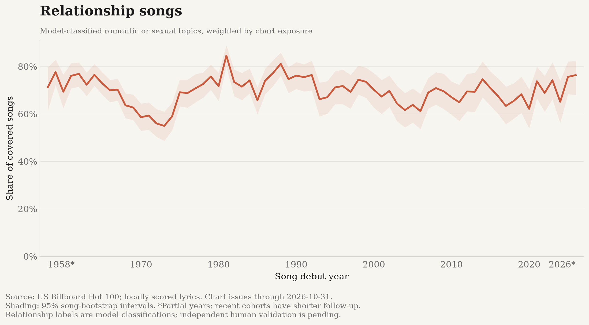

<div align="center">
  <h1>Relationships and Mood in US Hit Songs</h1>
  <p>
    <a href="#us-hit-songs-since-1958">Overview</a> ·
    <a href="#explore-the-evidence">Evidence</a> ·
    <a href="#working-with-the-charts">Charts</a> ·
    <a href="#setup">Setup</a>
  </p>
</div>

---

## US hit songs since 1958

A Billboard Hot 100 retrospective covering **32,732 songs**, from August 4, 1958
through the **October 31, 2026 chart issue**. Sources were retrieved October 27;
analysis completed October 28. Chart issue dates can follow publication dates.
Lyrics cover **89.4% of songs** and **94.3% of chart exposure**.

<p align="center">
  
</p>

## Explore the evidence

**Relationships:** [findings and figures](reports/findings.md) and
[classification method and review rubric](METHODS.md).
“Relationship” means romantic or sexual relationships; independent human validation remains pending.

**Emotion:** [NRC VAD comparisons](reports/nrc_vad_robustness.json) and
[dependence-aware statistical tests](reports/nrc_vad_statistics.csv).
Word ratings are not a validated measure of song sadness.

**Coverage:** [remaining gaps](reports/gap_audit.json),
[unresolved songs](reports/lyrics_unresolved.csv), and [source notes](DATA_SOURCES.md).

## Working with the charts

[Substack originals](reports/figures) use the shared warm **#F7F5F0** house style.
[Margin of Error versions](reports/figures/page_background) use **#F5F5F5**.
Only opaque background pixels change; chart colours, labels, dimensions and
transparency are preserved. Both sets regenerate with the report. To re-export
existing figures:

```bash
uv run --locked --extra all music-tastes page-plots
```

## Setup

```bash
uv sync --locked --python 3.12 --extra all
uv run --locked --extra all music-tastes site
python3 -m http.server 8000 --directory site
```

Open `http://localhost:8000` for the local preview, both chart formats and
complete aggregate downloads. Full refresh commands and private-data requirements
are in [METHODS.md](METHODS.md); raw lyrics and lexicons are not redistributed.

This is a fixed retrospective, not an automatically updated service.
Website deployment is separate work.
