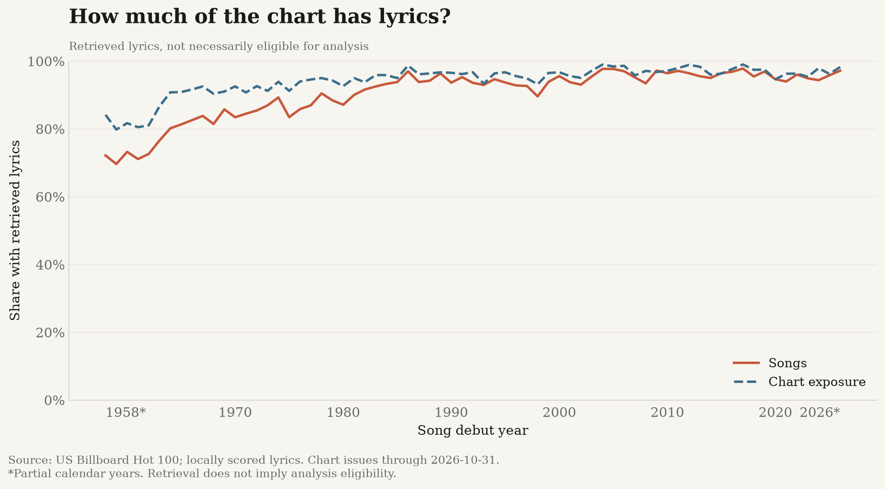
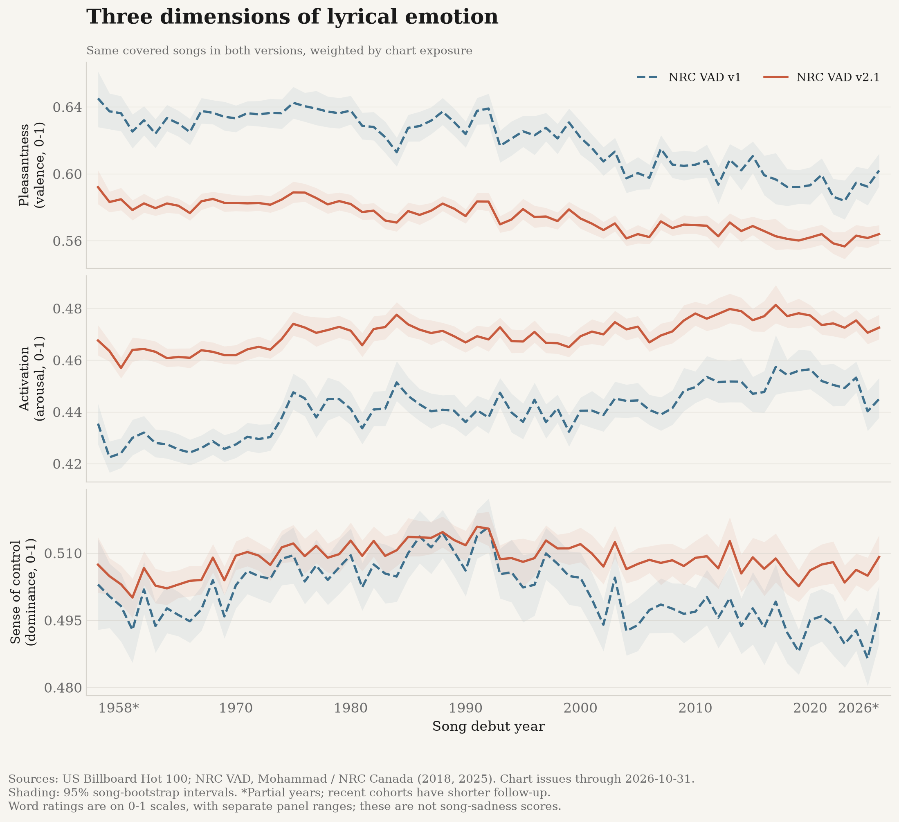
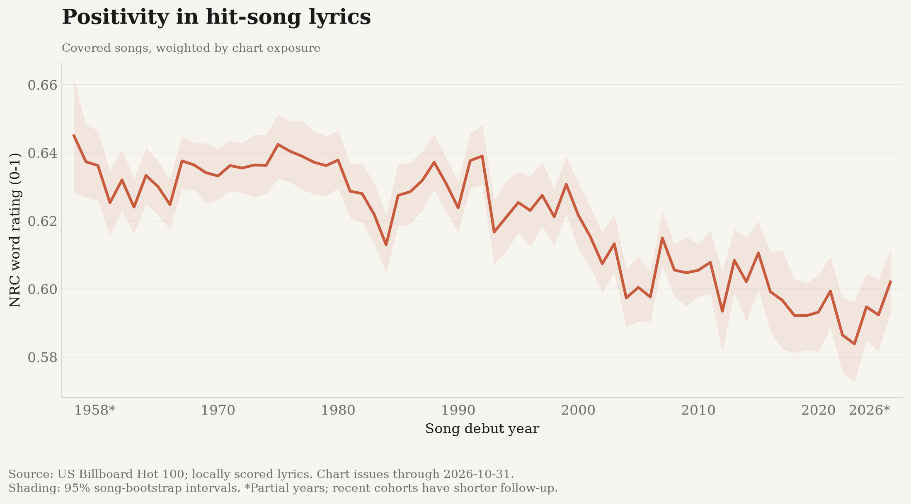
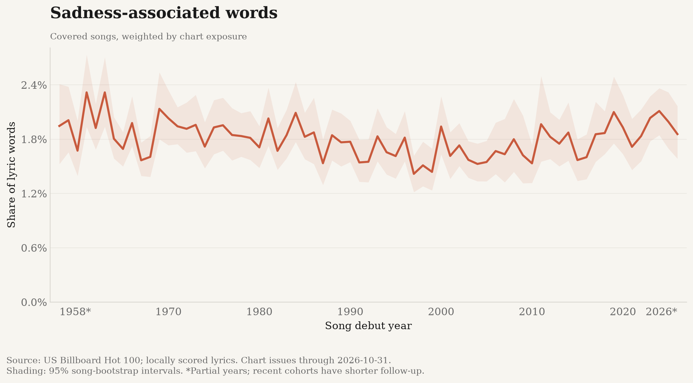
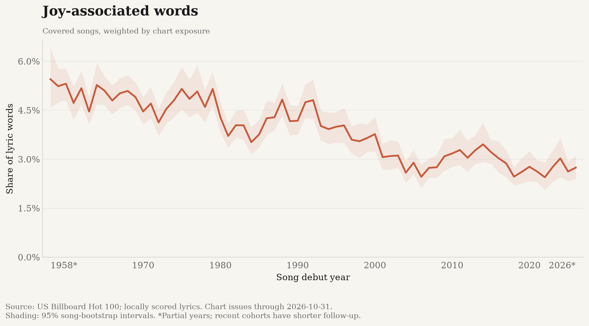
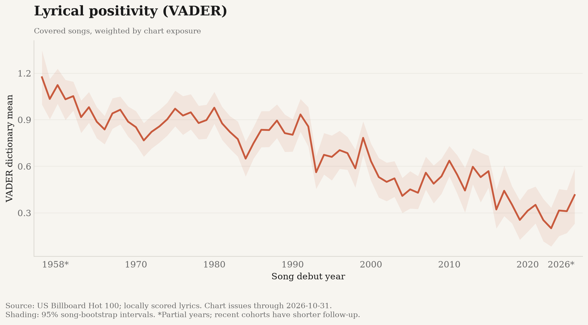
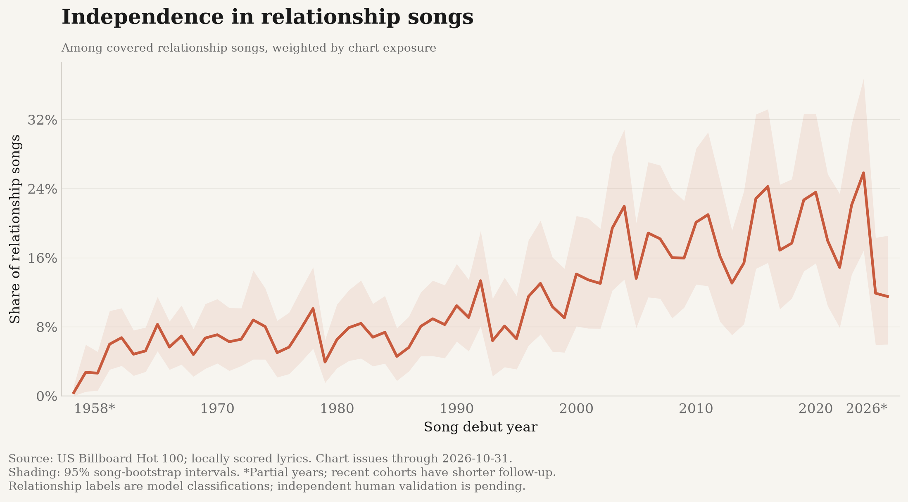
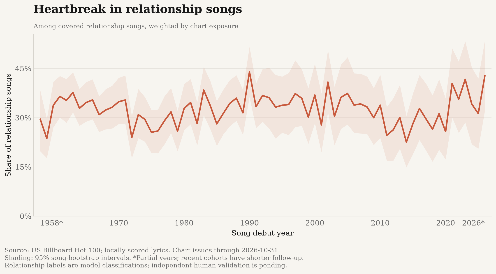
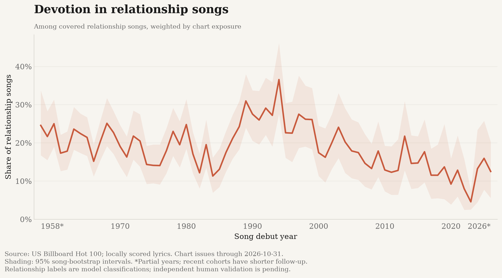
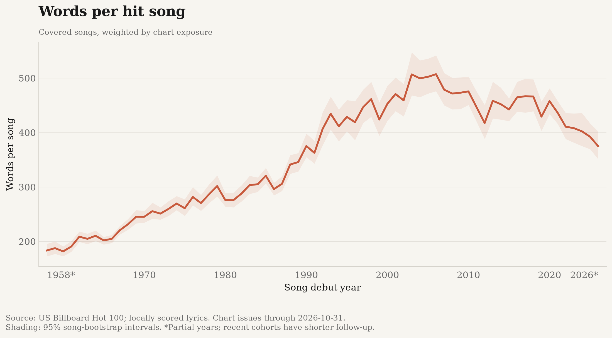

# Relationships and mood in US hit songs

_Generated 2026-10-28 23:00 UTC._

Chart issues through **2026-10-31**.
This is a retrospective snapshot, not an automatically updated series.
Issue dates can be later than publication dates. The latest year/decade is incomplete.

## What is being measured

**Relationship means romantic or sexual relationship**, not every form of love.
A local NLI model tests this topic on the first 380 cleaned words; scores >0.5
count as positive. Scores are not calibrated probabilities. Stances are scored
separately on chunks, then reported only within relationship-positive songs.
See [methods and review rubric](../METHODS.md).

Debut-year results describe cohorts using observed lifetime chart exposure.
They do not measure precisely what listeners heard in that calendar year.
See [chart-year comparison](chart_year_series.csv) for that alternative.
Recent cohorts have shorter observed chart lifetimes.

[Fixed 52-week follow-up](followup_52_week_series.csv) compares entirely
observed debut-year cohorts using only their first 52 calendar weeks of chart points.

## Coverage

Lyrics: **89.4%** of songs; **94.3%** of exposure.
A balanced high-exposure covered-song subset is a sensitivity check, not
proof that missingness bias has been removed. Metric-specific missingness remains.
See the [gap/change audit](gap_audit.json) and
[coverage changes by decade](coverage_change_by_decade.csv).

## Results

| Measure | Exposure-weighted debut-year trend |
|---|---|
| Positivity in hit-song lyrics | Decreasing (tau=-0.64, p=6.7e-15). |
| Sadness-associated words | No statistically clear monotonic trend (tau=-0.13, p=0.11). |
| Joy-associated words | Decreasing (tau=-0.72, p=1.7e-18). |
| Lyrical positivity (VADER) | Decreasing (tau=-0.76, p=4.4e-20). |
| Relationship songs | No statistically clear monotonic trend (tau=-0.10, p=0.24). |
| Independence in relationship songs | Increasing (tau=+0.67, p=2.5e-16). |
| Heartbreak in relationship songs | No statistically clear monotonic trend (tau=+0.03, p=0.75). |
| Devotion in relationship songs | Decreasing (tau=-0.32, p=9.8e-05). |
| The tempo of hit songs | Insufficient evidence to estimate a trend. |
| Hit songs in a minor key | Insufficient evidence to estimate a trend. |
| Audio happiness scores | Insufficient evidence to estimate a trend. |
| Audio sadness scores | Insufficient evidence to estimate a trend. |
| Words per hit song | Increasing (tau=+0.68, p=1.2e-16). |

## NRC VAD version and scoring sensitivity

Compared **28,874 identical songs** across all scoring variants,
from **28,885 eligible lyrics**.
NRC VAD v2.1 is rescaled from its native -1 to +1 to 0-1 before comparison
with the unchanged v1 baseline. These are word/phrase ratings, not percentages
of happiness, a validated sadness classifier, or listener-emotion measurements.

| Matched-song valence measure | Change per decade (0-1 units) | Kendall tau |
|---|---:|---:|
| v1_tokens | -0.0074 | -0.64 |
| v1_shared_tokens | -0.0069 | -0.63 |
| v21_shared_tokens | -0.0068 | -0.63 |
| v21_tokens | -0.0038 | -0.68 |
| v21_types | -0.0035 | -0.72 |
| v21_phrases | -0.0042 | -0.69 |
| v21_polar_0167 | -0.0066 | -0.67 |
| v21_polar_0333 | -0.0085 | -0.71 |

The shared-vocabulary variants hold matched words constant while changing
their version-specific ratings; expanded-vocabulary variants also change coverage.

Unique-word scoring removes repetition. Phrase scoring uses longest
nonoverlapping terms within lines/sections, without also counting their component words.
Polar-word sensitivities use fixed native valence thresholds of +/-0.167 and +/-0.333.
Arousal and dominance remain separate dimensions, not an invented sadness index.
Completed-period, minimum-match, chart-year, fixed-follow-up, and length/coverage
checks are exploratory; agreement does not establish historical invariance or causality.

[Complete annual series and intervals](nrc_vad_series.csv) |
[Annual token coverage](nrc_vad_coverage.csv) |
[Methods, provenance, controls and trend results](nrc_vad_robustness.json)

### Dependence-aware statistical checks

Completed years **1959-2025**; partial boundary years excluded.
Linear slopes use Newey-West serial-correlation/heteroskedasticity-robust
inference. The table uses five annual lags and Holm correction across the
three primary v2.1 dimensions. Intervals are pointwise 95%, not simultaneous.

| Dimension | OLS change/decade | 95% HAC interval | Holm-adjusted p |
|---|---:|---|---:|
| Arousal | +0.00210 | [+0.00136, +0.00284] | 7.59e-07 |
| Dominance | +0.00010 | [-0.00085, +0.00105] | 0.838 |
| Valence | -0.00380 | [-0.00463, -0.00297] | 8.69e-13 |

All three-, five- and ten-year HAC windows and circular residual-block
bootstrap checks are available below, including multiplicity correction
over all 67 comparisons and paired version contrasts.
These are retrospective checks, not preregistered confirmation. Failure
to reject zero does not establish a flat trend or equivalence. Tests do not
validate song sadness, remove coverage bias, or establish causality.

[Complete statistical tests](nrc_vad_statistics.csv) |
[Settings, assumptions and results](nrc_vad_statistics.json)

## Classifier validation

Independent relationship review: **partial**.
Conditional stance review: **pending**.
- Legacy random_sample, method_b_relationship: n=26, accuracy=1.00. Selection/annotation provenance is not independently audited; purposive results are not population accuracy.
- Legacy random_sample, method_a_relationship: n=26, accuracy=0.69. Selection/annotation provenance is not independently audited; purposive results are not population accuracy.
- Legacy purposive_sample, method_b_independence: n=13, accuracy=1.00. Selection/annotation provenance is not independently audited; purposive results are not population accuracy.
- Legacy purposive_sample, method_a_independence: n=13, accuracy=0.54. Selection/annotation provenance is not independently audited; purposive results are not population accuracy.

Chunk-count-adjusted independence estimate: +0.0127/decade (p=3.5e-24).

## Robustness and limitations

Primary tests are exploratory associations, not causal estimates. Annual series
can be autocorrelated; reported rank-test p-values are not a correction for all
tested hypotheses. Coverage agreement alone does not establish representativeness.
English/non-instrumental eligibility and source/recording matching restrict the sample.
AcousticBrainz stopped accepting submissions in 2022: missing recent audio is
not evidence of no musical change. Audio mood scores are classifier outputs,
not direct measurements of human emotion.

[Confounds](confounds.json) | [Construct validity](validity.json) |
[Wording sensitivity](prompt_robustness.json) |
[Relationship wording/input sensitivity](relationship_sensitivity.json) |
[Threshold sensitivity](relationship_threshold_sensitivity.json) |
[Gold validation](gold/validation.json)

### Positivity in hit-song lyrics

### Sadness-associated words

### Joy-associated words

### Lyrical positivity (VADER)

### Relationship songs

### Independence in relationship songs

### Heartbreak in relationship songs

### Devotion in relationship songs

### Words per hit song

